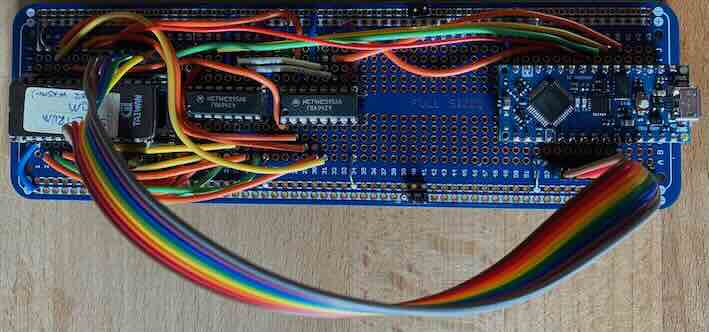

# EEPROM Reader

## Overview

This project allows you to read an old 5v 27cxxx style EEPROM.

It also has a schematic for the design using KiCAD. I haven't made a PCB yet but this shouldn't be difficulty since it's a very simple circuit. 

The Arduino-based software also has hardware debug commands as well as read commands for 27C64, 27C128, 27C256 and 27C512. Only 27C64 and 27C128 have been tested - but I don't see why the others won't work.

The software is licensed under the MIT license, so you can modify it as you like.

The programming can be done with a standard USB lead and the Arduino IDE. 

## Command Interface

In order to read the EEPROMs you need to send a command to the Arduino. 

Serial Baud rate for command interface = 230400 baud. 8 data bit, 1 stop bit, no parity (8N1).

I tend to use [CoolTerm](https://freeware.the-meiers.org/#CoolTerm) but any serial terminal should work. If you use Coolterm remember to turn Backspace and Bell Character support in the data Handling part of options. 

The basic commands are shown on startup:

    > Hello, Welcome to Rob's EEPROM reader

    27C64 = Read 8KBytes EEPROM
    27C128 = Read 16KBytes EEPROM
    27C256 = Read 32KBytes EEPROM
    27C512 = Read 64KBytes EEPROM
    words = to see other commands

    > 27c64
    Reading EEPROM: 27C64

    0000: 31 FE 47 DB FB CB 7F 28 3E E6 04 0E FE 32 14 40 
    0010: 47 21 00 00 11 FF FF CD 3A 00 11 00 FF 3A 14 40 

As you can  see you just type the command required - 27c64 in the above case. 

It has several other commands - mostly to help you debug your hardware if you have connection problems. Some of these take parameters and you put these BEFORE the command. 

Numbers are either in decimal, or hexadecimal with a $ in front.

## Command Examples

Here are some examples. 

Read 32 bytes from address zero

    > 0 32 read_block

    0000: 00 AF 11 FF FF C3 CB 11 2A 5D 5C 22 5F 5C 18 43 
    0010: C3 F2 15 FF FF FF FF FF 2A 5D 5C 7E CD 7D 00 D0 

Read 16 bytes from address 3F00 hexadecimal

    > $3F00 $10 read_block

    3F00: 00 1C 22 78 20 20 7E 00 00 00 38 04 3C 44 3C 00 

Wait for half a second (500 milliseconds)

    > 500 ms

You can chain commands on one line. For instance to toggle the EEPROM output enable pin, with 100 milliseconds between. Setting the output enable to 0 (0v, logic 0, enabled) first then waiting 100 milliseconds, then setting the output enable to 1 (5v, logic 1, disabled).)

    > 0 oe! 100 ms 1 oe!

The complete list of commands is:

    words - Show the list of words
    help - Show the help for the commmand that follows help
    ? - Show the help for the commmand that follows help
    27C64 - Read 27C64
    27C128 - Read 27C128
    27C256 - Read 27C256
    27C512 - Read 27C512
    welcome - Show welcome message
    read - Read the data bus
    addr! - Write address bus
    oe! - Write EEPROM OE Pin
    cs! - Write EEPROM CE Pin
    ser! - Write 75HC595 Serial Pin
    clk! - Write 75HC595 Clk Pin
    latch! - { state -- } Write 75HC595 Latch Pin
    ms - { time -- } Delay milliseconds
    . - Print number off stack
    .s - Print all numbers of stack
    read_block - { addr size -- } read a block of data
    read_delay! - { microseconds -- } set wait after select

The notation { x y z -- a b c } shows what parameters you pass in (x, y, z) and what parameters it returns ( a b c).

The command `.s` shows what's on the data stack (they continue to exist across different lines) and . prints a value (and drops it from the stack).

For instance this reads the databus (which leaves the 8-bit value read from the data bus on the stack) and `.` prints the value.

    > read .
    255

This shows the difference between .s and .
    > 1 2 3 .s . 
    < 1 2 3 > 
    3

    > .s
    < 1 2 > 

## Arduino GPIO Assignment

The data is read via D2 to D9, and the three 745HC595 control lines and two EEPROM control are on A0 to A4, although my prototype hardware uses different GPIO. (You can see the two options at the top of `EEPROM_reader.ino`).

## Components Required

In the design I've used a Arduino Nano Every mostly because I had a spare not doing anything and it fitted onto standard breadboard PCB, unlike the Arduino Uno header. Any 5v device will do. Obviously if you use any 3v part then you need voltage translation for the output control and data inputs. It's not hard to do this, but it does add complexity to what should be a simple design. 

## Other Notes

I've had problems reading an old 27C64, but ultimately it works. This chip had a normal sticker not a foil backed sticker, so I did wonder if this device was having problems due to partial erasure. However, using a simple logic probe shows problems with output of one fothe 74HC595 chips. I never got to the bottom because I read the chip, and other EEPROMs don't show the same failure.

The use of 74LS vs. 74HC series logic is your choice, but generally I use 74HC series logic because the Arduino is a CMOS device and doesn't generally use TTL levels. Since the two shift registers are only used for address output it seems unlikely that 74HCT logic is required - 74HCT differs from 74HC in terms of input thresholds, so since we are not receiving any lines, 74HC is fine.

